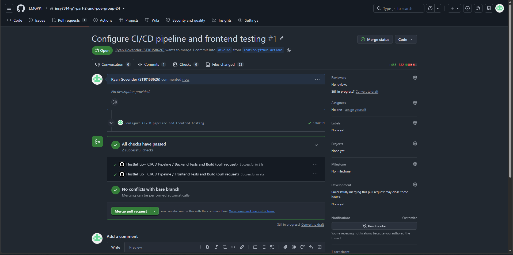
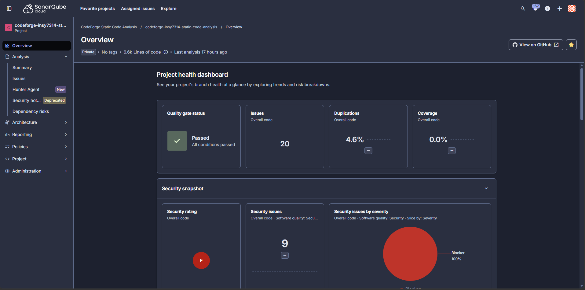
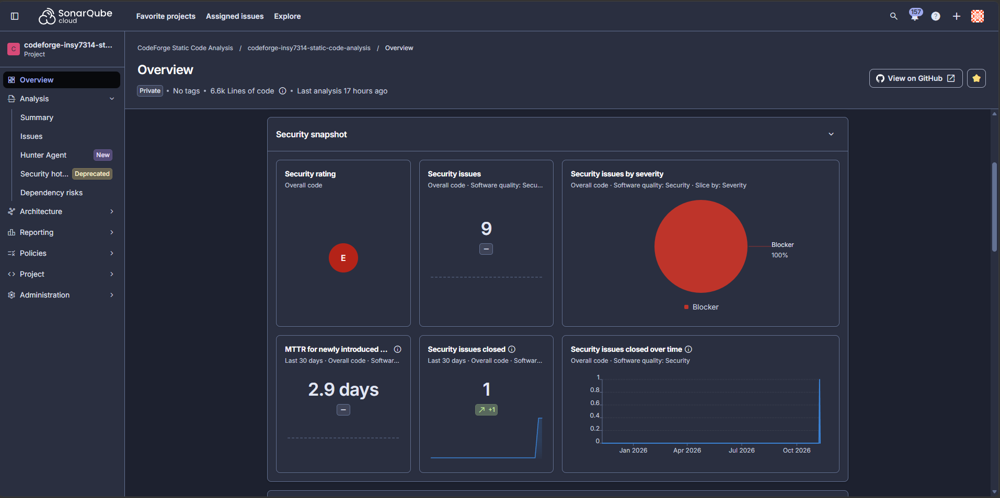
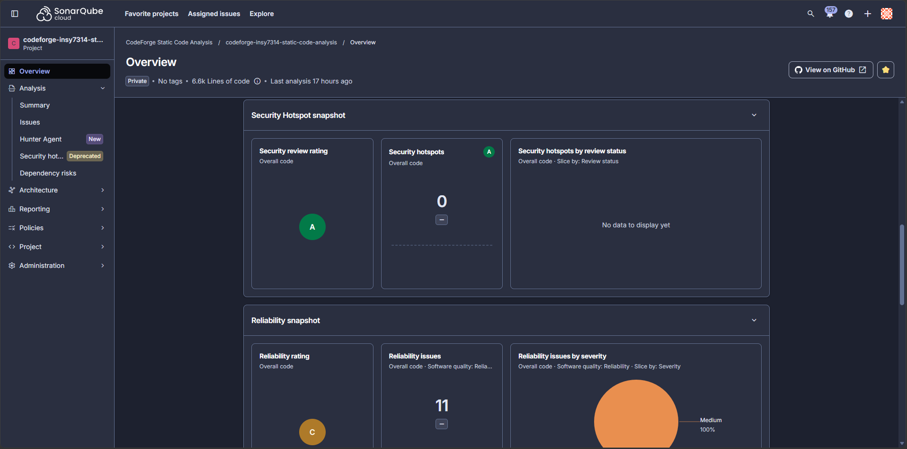
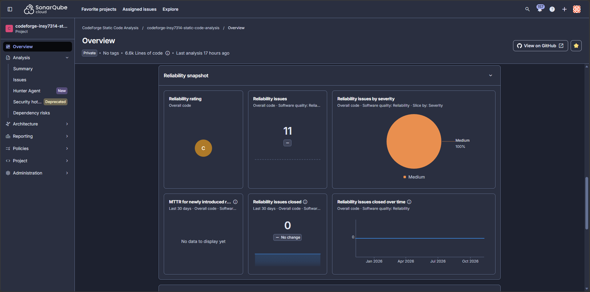
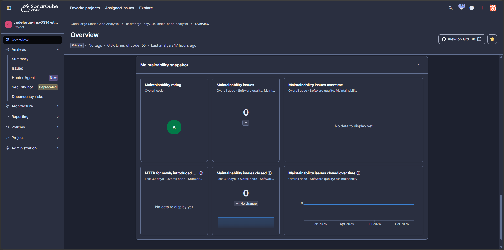
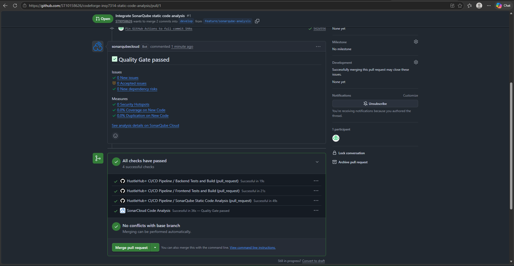
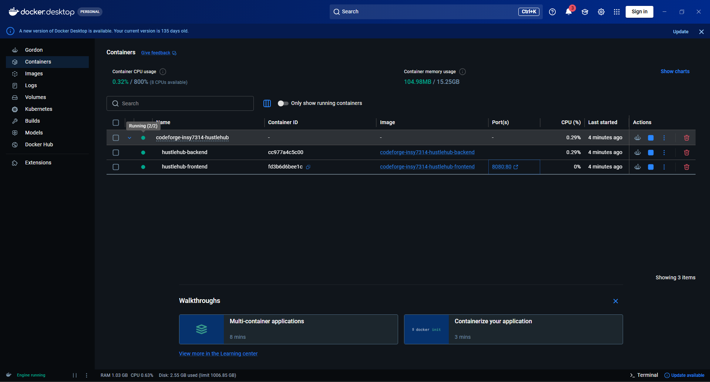
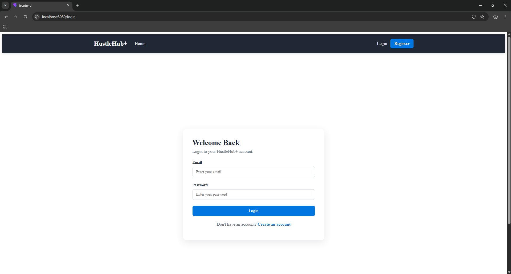

# HustleHub+ API - Project Documentation (Part 1)

## Project Overview
HustleHub+ is a RESTful backend API built with Node.js and Express.js. The main aim of the project is to demonstrate a
well-structured, secure and maintainable backend for user authentication and protected user functionality.

### The project demonstrates:
* Professional project structure and documentation
* A clear API architecture and request flow
* User registration and login
* Input validation
* Password hashing with bcrypt
* JWT-based authentication
* Protected routes
* Appropriate HTTP status codes and error responses
* Security considerations and the reasoning behind design decisions

### Main Objectives
1.	 Build a REST API using Node.js and Express.js.
2.	 Separate routes, controllers, middleware and storage
responsibilities.
3.	 Validate user input before it reaches controller logic.
4.	 Secure passwords using bcrypt hashing.
5.	 Protect authenticated endpoints using JSON Web Tokens (JWT).
6.	 Return clear and meaningful error responses.
7.	 Document the request flow and architecture.
8.	 Explain why the major technical and security decisions were made.

### Explanation of the System
HustleHub+ is a secure freelance marketplace platform designed to connect freelancers with clients. Freelancers can advertise their services, while clients can browse available services and book freelancers.
The backend of the system is developed using Node.js and Express. It provides API endpoints that allow users to register, log in, and access authenticated functionality.
Since the application handles user accounts and sensitive information, security is an important part of the system. The application uses password hashing, token-based authentication, input validation and HTTPS to help protect users and their information.

### Intended Users
HustleHub+ is intended for the following users:
1. Freelancers - Freelancers use the platform to advertise their skills and services. They can create a profile and make their services available to potential clients.
2. Clients - Clients use the platform to browse available freelance services and book services that meet their requirements.
3. Administrators - Administrators can be responsible for managing the platform and monitoring users and system activity.

## Architecture Diagram

## Request Flow
A normal request follows this flow:
1.	 The client sends an HTTP request containing JSON data.
2.	 Express reads the JSON body using express.json().
3.	 The request is matched to the correct route.
4.	 Validation middleware checks the supplied input.
5.	 Invalid input is rejected with a 400 Bad Request response.
6.	 Valid input is passed to the controller.
7.	 The controller performs the required application logic.
8.	 Registration hashes the password before storing the user.
9.	 Login verifies the credentials and creates a JWT.
10.	 Protected routes verify the JWT before returning protected information.
11.	 The API sends a JSON response to the client.
12.	 Unknown routes are handled by the 404 handler.
13.	 Unexpected errors are handled by the global error handler.

### server.js
The main entry point. It loads environment variables, creates the Express application, enables JSON parsing, registers routes, provides
the health check, handles 404 responses and registers the global error handler.

### routes/
Defines API endpoints and connects them to middleware and controllers.

### controllers/
Contains the main authentication logic such as registration, duplicate-email checking, password hashing, login and JWT generation.

### middleware/
Contains reusable processing that happens before or around controller logic.
* inputValidation.js - validates request data.
* authMiddleware.js - verifies JWT bearer tokens.
* errorHandler.js - provides central error handling.

### storage/
Contains the current in-memory user store. The array-based store is suitable for demonstrating the API and can later be replaced with a database.

### certs/
Contains the locally configured SSL certificate and private key used to serve the application over HTTPS.

### .env
Stores sensitive configuration values such as secret keys. These values should not be exposed in the source code.

### Health Check
GET /api/health
Example response:
{
    "success": true,
    "status": "API is running"
}

### Register
POST /api/auth/register
Example request:
{
    "name": "John",
    "surname": "Smith",
    "email": "john@example.com",
    "password": "Password123"
}

A successful registration returns 201 Created.

Validation checks include:
* Required name
* Required surname
* Required email
* Required password
* Name length
* Surname length
* Email format
* Minimum password length

Invalid input must be rejected before an account is created.

### Login
POST /api/auth/login
Example request:
{
    "email": "john@example.com",
    "password": "Password123"
}
A successful login returns a JWT token that can be used to access protected routes.

### Profile
GET /api/users/profile
This endpoint is protected by JWT authentication.
The request must contain:
Authorization: Bearer JWT_TOKEN
The authentication middleware verifies the token before allowing access.

## Token Usage

The JWT secret is stored in an environment variable instead of being hard-coded.
Example:
PORT=3000
JWT_SECRET=your_secret_key
The real .env file should not be committed to a public repository.

## Validation Approach
Input validation is implemented as middleware. This keeps validation separate from the main controller logic.
For example, an invalid registration request:
{
    "name": "J",
    "surname": "",
    "email": "not-an-email",
    "password": "123"
}
should be rejected with a 400 Bad Request response.

This approach:
* Prevents invalid data from reaching the controller
* Keeps controllers easier to read
* Makes validation reusable
* Provides predictable responses
* Reduces unnecessary processing

## Error Handling
The API uses HTTP status codes to communicate results.

* 200	- OK - Successful request
* 201	- Created - User successfully registered
* 400 - Bad Request - Invalid or missing input
* 401 - Unauthorized - Invalid credentials or JWT
* 404 - Not Found - Unknown API route
* 409 - Conflict - Email already registered
* 500 - Internal Server Error - Unexpected server error
* The API uses JSON responses so Postman and frontend applications can process the responses consistently.

## Security Rationale

### Password Hashing
Passwords are not stored as plain text. bcryptjs is used to hash passwords before they are stored.

During login, the submitted password is compared with the stored hash.

### JWT Authentication
JWT authentication protects endpoints that require an authenticated user.
The middleware rejects missing, invalid or expired tokens with 401 Unauthorized.

### Environment Variables
Sensitive configuration, particularly the JWT secret, is kept in .env and accessed through process.env.
This avoids placing secrets directly in source code.

## Why This Architecture Was Chosen
The project uses separation of responsibilities so that each part of the application has a clear purpose.

This is easier to maintain than placing all API functionality inside server.js.
It also makes future features easier to add. For example:
controllers/
    authController.js
    userController.js
    jobController.js

routes/
    authRoutes.js
    userRoutes.js
    jobRoutes.js

middleware/
    authMiddleware.js
    inputValidation.js
    errorHandler.js

## HTTPS Configuration
The application is now served over HTTPS using a configured SSL certificate. HTTPS encrypts communication between the client and the API, helping protect authentication credentials, JWT tokens and other data while it is transmitted. The API can therefore be tested using an HTTPS address rather than only an unsecured HTTP connection.
For local development, ensure the configured SSL certificate is available and that the HTTPS settings match the project's server configuration.

## Postman API Testing Collection
A Postman collection has been created for the HustleHub+ API to test all available API endpoints.
The collection covers:
* GET /api/health
* POST /api/auth/register
* POST /api/auth/login
* GET /api/users/profile
* Input validation tests
* Authentication/token testing
* Error-response testing

The collection provides a repeatable way to demonstrate that the API endpoints work correctly and that valid and invalid requests receive the expected responses.
For the protected profile endpoint, the JWT returned by the login request is used as a Bearer Token in the request authorization.
The Postman collection can also be used as evidence that the API has been systematically tested rather than only testing individual requests manually.

## Testing With Postman
1. Health Check
GET http://localhost:3000/api/health

2. Register
POST http://localhost:3000/api/auth/register
Body → raw → JSON:
{
    "name": "John",
    "surname": "Smith",
    "email": "john@example.com",
    "password": "Password123"
}

3. Test Validation
Try:
{
    "name": "J",
    "surname": "",
    "email": "invalid",
    "password": "123"
}
The request should be rejected with 400 Bad Request.

4. Login
POST http://localhost:3000/api/auth/login
Body:
{
    "email": "john@example.com",
    "password": "Password123"
}
Copy the returned JWT.

5. Test the Protected Route
GET http://localhost:3000/api/users/profile
In Postman:
Authorization -> Bearer Token -> Paste JWT
A valid token should allow access. A missing or invalid token should return 401 Unauthorized.

### Example Error Responses:

Validation Error
{
    "success": false,
    "error": "ValidationError",
    "message": "Invalid request data."
}

Unauthorized
{
    "success": false,
    "error": "Unauthorized",
    "message": "Invalid or expired token."
}

Route Not Found
{
    "success": false,
    "error": "NotFoundError",
    "message": "The requested route was not found."
}

## Key Design Decisions
* Express.js - Used as the HTTP server framework because it provides simple middleware and routing structure.
* Middleware - Used for validation, authentication and error handling so that these responsibilities are kept separate from controllers.
* bcryptjs - Used to avoid storing user passwords as plain text.
* JWT - Used for authentication so that the client can present a signed token when accessing protected endpoints.
* In-Memory User Store - Currently uses an array for simplicity during development. A database can be introduced later without redesigning the overall API structure.

## Future Improvements
* Replace the in-memory store with a database.
* Add role-based authorisation.
* Add refresh tokens.
* Add stronger password rules.
* Add automated unit tests.
* Add integration/API tests.
* Add Swagger/OpenAPI documentation.
* Add rate limiting.
* Add request logging.
* Add production configuration.
* Deploy the API to a cloud platform.

## Professional Development Practices Demonstrated
The project aims to demonstrate:
* Well-organised folder structure
* Separation of concerns
* Meaningful naming
* Input validation
* Secure password handling
* JWT authentication
* Consistent HTTP status codes
* Centralised error handling
* Environment-based configuration
* Clear API request flow
* HTTPS communication using an SSL certificate
* Postman collection covering all API endpoints
* Comments explaining important decisions
* Documentation of security choices

The focus is not simply making the API work, but demonstrating why each architectural, validation and security decision is made.

# HustleHub+ - Frontend and Backend Source Bundle (Part 2)

This folder contains the existing React/Vite frontend and Node/Express/Mongoose HTTPS API, plus security middleware, a freelancer income endpoint/page, and starter automated tests.

## Tests

- Backend smoke/security tests: cd api && npm test
- Frontend rendering tests: cd frontend && npm test
- Frontend production build: cd frontend && npm run build
- Postman collection: import postman-collection/HustleHub+ API Tests - CodeForge.postman_collection.json; use https://localhost:3444 as the base URL and disable certificate verification only for local development if needed.
- Newman run: cd api && npm run test:newman (requires Newman and the Postman collection variables/accounts to be configured).

## Implemented functionality

- Registration/login with password hashing, JWT authentication and role-based access.
- Gig browsing and freelancer gig CRUD.
- Client booking creation/cancellation and freelancer booking completion.
- Simulated transaction records and GET /api/bookings/freelancer/income for the signed-in freelancer.
- Request validation, input sanitisation, security headers, JSON body limit, auth/booking rate limits and consistent 404/error responses.
- Freelancer income summary screen at /freelancer/income.

## Important limitations

- Transactions are simulated only; this is not a payment gateway or tax calculation service. totalIncome is a gross sum of eligible simulated transactions and is not tax advice.
- The automated tests are starter smoke/security/UI tests. Complete database-backed integration tests and run the full Postman suite against your own configured database before claiming all tests pass.
- The rate limiter is in-memory and suitable for local coursework/single-process development; use a shared store for multi-instance production deployments.

# HustleHub+ - Final Project Documentation (POE)

## Installation and Setup

### Prerequisites
* Node.js 22 or later
* npm
* Git
* MongoDB Atlas account and database
* Docker Desktop

### Local Development Setup
1. Clone the repository: https://github.com/EMGPPT/insy7314-g1-part-2-and-poe-group-24.git
2. Navigate to the project directory: cd codeforge-insy7314-hustlehub+
3. Install backend dependencies: 
   *cd api 
   *npm ci
4. Create an api/.env file containing the required environment variables:
   *MONGODB_URI=your_mongodb_connection_string
   *JWT_SECRET=your_secure_jwt_secret
   *FRONTEND_ORIGIN=http://localhost:5173
   *TAX_ESTIMATE_RATE=0.15
   *PORT=3444
   *HOST=0.0.0.0
   *HTTPS_ENABLED=true
5. Configure the local HTTPS certificates required by the backend.
6. Start the backend: npm start
7. In a separate terminal, install and start the frontend:
   * cd frontend
   * npm ci
   * npm run dev

## Freelancer Income and Tax Estimation

The freelancer income page (`/freelancer/income`) displays the value of completed, non-cancelled simulated transactions. It provides three summary figures: gross income, estimated tax reserve and estimated after-tax income, together with proportional bars and transaction history.

### Tax estimation logic
The API calculates the estimate as follows:
1. Retrieve completed transactions belonging to the authenticated freelancer.
2. Exclude transactions linked to bookings that have been cancelled.
3. Add the remaining transaction amounts to calculate gross generated income.
4. Multiply gross income by the configured `TAX_ESTIMATE_RATE` (default `0.15`, or 15%).
5. Subtract estimated tax from gross income to show estimated after-tax income.

**Formula:** `estimatedTax = grossIncome × taxRate`; `afterTaxIncome = grossIncome − estimatedTax`.

For example, if eligible completed gigs generate R10,000 and the estimate rate is 15%, estimated tax is R1,500 and estimated after-tax income is R8,500. The API response includes `taxRate`, `estimatedTax`, `afterTaxIncome` and `taxMethod` alongside the income total.

To change the planning rate, add `TAX_ESTIMATE_RATE=0.15` to `api/.env`. Use a decimal between 0 and 1 (for example, `0.18` means 18%). This flat-rate estimate is deliberately presented as an illustrative reserve, not an official SARS tax calculation or tax advice. Real tax depends on an individual's taxable income, deductions, rebates and the tax rules for the relevant year. The rate is configurable so the demonstration assumption is transparent and can be changed without editing source code.

## Application Logging and Monitoring

The API writes structured, one-event-per-line JSON logs to `api/logs/application.log`. The log directory is created automatically. The following events are recorded:

| Event | Information captured | Why it matters |
|---|---|---|
| Login success | User ID, role, IP address and timestamp | Confirms successful account access and supports account activity reviews. |
| Login failure / blocked login | User ID when known, IP address, failed-attempt count and reason | Helps identify password guessing and suspicious access attempts. |
| Booking created, completed or cancelled | Booking ID, relevant user ID and event timestamp | Provides an audit trail for marketplace activity and disputes. |
| Transaction created | Transaction ID, booking ID, amount, status and type | Helps trace simulated payment records and reconcile booking activity. |
| API request | HTTP method, endpoint, response status, duration and IP address | Helps monitor usage, identify failing endpoints and investigate unusual traffic. |
| API error | Endpoint, status code, error type/message, user ID when available and IP address | Helps developers diagnose faults and identify repeated or suspicious errors. |

Passwords, password hashes, JWT tokens and full request bodies are deliberately not written to the logs. Logs are intended for operational monitoring and security investigation; they should be access-controlled and rotated/retained according to the deployment environment. In this development implementation, logs are stored locally in a file and are not yet sent to a central monitoring service.

## Additional Security Features
The system includes the following additional functional protections:

1. **Temporary account lockout:** After five consecutive incorrect password attempts for an existing account, login is blocked for 15 minutes. A successful login resets the counter. Expired locks are cleared when the user next attempts to log in. The API returns HTTP `423` while an account is locked. This adds account-level protection on top of the existing IP-based authentication rate limiter.
2. **Stronger password policy:** New registrations must use a password between 10 and 128 characters containing at least one uppercase letter, one lowercase letter, one number and one special character. Invalid passwords are rejected by registration validation before an account is created.

Other existing protections include bcrypt password hashing, one-hour JWT expiry, role-based route authorisation, request input validation/sanitisation, security headers, HTTPS for local API development, and separate rate limits for authentication and booking creation.

## Security Implementation
A final security review was conducted to address common web application threats.

| Security Threat            | Implemented Protection                                                                                                                                                                               |
| -------------------------- | ---------------------------------------------------------------------------------------------------------------------------------------------------------------------------------------------------- |
| Injection attacks          | Server-side request validation and input sanitisation are applied before processing user input. Mongoose is used for database interactions rather than constructing raw SQL queries.                 |
| Cross-Site Scripting (XSS) | React's default output escaping helps prevent untrusted values from being interpreted as HTML. Request input validation/sanitisation and security headers provide additional protection.             |
| Authentication weaknesses  | Passwords are hashed using bcrypt. JWT authentication uses a one-hour token expiry. Authentication rate limiting and temporary account lockout help protect against repeated login attempts.         |
| Weak passwords             | Registration enforces a password length of 10–128 characters, including uppercase, lowercase, numeric and special characters.                                                                        |
| Broken access control      | Role-based authorisation restricts protected API routes and functionality according to the authenticated user's role.                                                                                |
| Brute-force attacks        | After five consecutive incorrect password attempts for an existing account, login is blocked for 15 minutes. Authentication endpoints also use IP-based rate limiting.                               |
| Unencrypted communication  | HTTPS is supported for local API development. Inside Docker, HTTP is used for internal container-to-container communication, with the frontend and API accessed through the Nginx frontend endpoint. |

### Additional Security Considerations
* Authentication information is obtained from the verified JWT rather than trusting user identifiers supplied by the client.
* Passwords, password hashes and JWT tokens are excluded from application logs.
* Environment variables are used to supply sensitive configuration.
* Docker .dockerignore files exclude environment files and local certificates from image build contexts.
* The frontend and backend use separate containers, with the backend API port exposed internally rather than published directly to the host.

## Testing and CI/CD Pipeline
The project uses GitHub Actions to automatically validate backend and frontend changes.

### Automated Testing
The backend uses the Node.js test runner:
* cd api
* npm test
* npm run build

The frontend uses its configured test, lint and production build scripts:
* cd frontend
* npm test
* npm run lint
* npm run build

### GitHub Actions Pipeline
The CI/CD pipeline runs when changes are submitted through pull requests and validates the application components. It helps identify errors before changes are merged into the develop branch.

1. Backend Tests and Build: Runs backend tests and checks the backend build.
2. Frontend Tests and Build: Runs frontend tests and verifies that the frontend production build succeeds.

### Pipeline evidence:

## Static Code Analysis
Due to GitHub organization restrictions, forking the original Classroom repository to a personal GitHub account was not permitted. Additionally, the original repository could not be connected directly to SonarQube Cloud because of organization-level permission restrictions. As a result, a separate personal repository was created to facilitate the integration of SonarQube Cloud and the execution of static code analysis through GitHub Actions. The personal repository contains the project's code, relevant commit history, and the SonarQube-integrated CI/CD pipeline. It is used to execute static code analysis and provide access to the corresponding analysis results.

**Personal Repository for Static Code Analysis:** https://github.com/ST10158626/codeforge-insy7314-static-code-analysis.git

### Forking Restriction

### SonarQube Integration Restriction

### SonarQube Analysis Results
SonarQube Cloud was used to perform static code analysis on the HustleHub+ project. The analysis evaluates code quality, reliability, security and maintainability. The latest analysis produced the following results:

| Metric                 | Result              |
| ---------------------- | ------------------- |
| Lines of Code          | Approximately 6,600 |
| Quality Gate           | Passed              |
| Total Issues           | 20                  |
| Security Issues        | 9 (Blocker)         |
| Reliability Issues     | 11 (Medium)         |
| Security Hotspots      | 0                   |
| Maintainability Issues | 0                   |
| Code Duplication       | 4.6%                |
| Code Coverage          | 0.0%                |

### Analysis Interpretation
* Quality Gate: Passed, indicating that all configured Quality Gate conditions were satisfied.
* Security: The security rating is E because nine high-impact security issues were identified. These require further investigation and remediation.
* Reliability: The C rating reflects eleven medium-severity issues that could potentially affect application reliability.
* Maintainability: The A rating indicates that no maintainability issues were detected.
* Security Review: The A rating indicates that no Security Hotspots were identified in this analysis.
* Code Duplication: The duplication rate of 4.6% indicates a relatively low level of duplicated code.
* Code Coverage: Coverage is reported as 0.0%, meaning coverage information was not available to SonarQube during this analysis.

Although the Quality Gate passed, the identified security and reliability issues demonstrate that further code review and remediation are necessary. A passing Quality Gate does not guarantee that the application is free from security vulnerabilities or defects.

## Docker Containerization
HustleHub+ supports containerized execution using Docker and Docker Compose. The application consists of two containers:
1. Backend - Runs the Node.js and Express API.
2. Frontend - Serves the React production build through Nginx and forwards API requests to the backend.

### Running with Docker Compose
1. Make sure Docker Desktop is running and that api/.env contains the required database connection string and JWT secret.
2. Build and start the application: docker compose up --build -d
3. Check container status: docker compose ps
4. Access the application: http://localhost:8080
5. Test the backend health endpoint through the Nginx reverse proxy: curl http://localhost:8080/api/health
6. Stop the application: docker compose down

The backend includes a health check, and Docker Compose waits for the backend to become healthy before starting the frontend.

### Docker Demonstration Evidence

# Reference List

* Coding2GO, 2025. All the Express.js You Need — Explained in 24 Minutes.
[video online] Available at:
https://youtu.be/ha_leEpnT30
[Accessed 21 August 2026].

* NPM, 2025. bcrypt.js.
[online] Available at:
https://www.npmjs.com/package/bcryptjs
[Accessed 21 August 2026].

* Dave Gray, 2021. User Password Authentication | Node.js & Express Tutorials for Beginners.
[video online] Available at:
https://youtu.be/Nlg0JrUt0qg
[Accessed 21 August 2026].

* Dave Gray, 2021. JWT Authentication | Node JS and Express Tutorials for Beginners.
[video online] Available at:
https://youtu.be/favjC6EKFgw
[Accessed 23 August 2026].

* Web Dev Simplified, 2019. JWT Authentication Tutorial - Node.js.
[video online] Available at:
https://youtu.be/mbsmsi7l3r4
[Accessed 23 August 2026].

* The Independent Institute of Education (IIE), 2026.
Information Systems 3D [INSY7314/w Module Manual 2026].
The Independent Institute of Education.
[online via internal VLE] Available at:
https://advtechonline.sharepoint.com/:w:/r/sites/TertiaryStudents/IIE%20Student%20Materials/Student%20Materials/INSY7314/2026/Term%202/INSY7314MM.docx?d=w58b815c8d5924d47bda04f6761924e1b&csf=1&web=1&e=xcnarK
[Accessed 23 August 2026].

* Express.js (2026) *Using middleware*. Available at:
https://expressjs.com/en/guide/using-middleware/ (Accessed: 4 September
2026).

* Express.js (2026) *Writing middleware for use in Express apps*.
Available at: https://expressjs.com/en/guide/writing-middleware/
(Accessed: 4 September 2026).

* Express.js (2026) *Error handling*. Available at:
https://expressjs.com/en/5x/guide/error-handling/ (Accessed: 4 September
2026).

* Express.js (2026) *Express FAQ*. Available at:
https://expressjs.com/en/starter/faq/ (Accessed: 4 September 2026).

* Node.js (2026) *Environment Variables*. Available at:
https://nodejs.org/api/environment_variables.html (Accessed: 4 September
2026).

* npm (2026) *dotenv*. Available at: https://www.npmjs.com/package/dotenv
(Accessed: 4 September 2026).

* Net Ninja, 2022. MERN Stack Tutorial #8 - Making a React App.
[video online] Available at:
https://youtu.be/bx4nk7kBS10?si=DJABJs8sT4RtJf_Q
[Accessed 24 September 2026].

* DesiCoderPankaja, 2026. React Installation and Setup | Create React App using Vite | React Tutorial for Beginners #3.
[video online] Available at:
https://youtu.be/6I4kPKM_GS8?si=fkKFTtkizIhD0zR3
[Accessed 24 September 2026].

* Code With Yousaf, 2023. MERN Stack CRUD Operations | Full Stack CRUD Operations | React, Node, Express & MongoDB.
[video online] Available at:
https://youtu.be/enOsPhp2Z6Q?si=Z24vkN26TDJMyOCQ
[Accessed 25 September 2026].

* OnlineITtuts Tutorials, 2025. MERN Stack CRUD App for Beginners | Complete Full Stack Project.
[video online] Available at:
https://youtu.be/2ARIweIiNhs?si=j_WG_86iv5rMgSXl
[Accessed 25 September 2026].
 
* Traversy Media, 2022. Learn The MERN Stack - JWT Authentication.
[video online] Available at:
https://youtu.be/enopDSs3DRw?si=9I4p9hlpT6SIB0aN
[Accessed 28 September 2026].

* Medium, 2025. JWT Authentication in MERN Apps: A Beginner-Friendly Guide.
[online] Available at: https://medium.com/@adityamohiteakm/jwt-authentication-in-mern-apps-a-beginner-friendly-guide-00ed6b6405fc
[Accessed 28 September 2026].

* GitHub Docs, NA. GitHub Actions documentation.
[online] Available at: https://docs.github.com/en/actions
[Accessed 05 November 2026].

* OpenAI. 2026. Chat-GPT (Version 5.6). 
[Large language model]. Available at: <https://chatgpt.com/share/6af19790-1878-83ea-b3fe-ea33baae9ba9> 
[Accessed 05 November 2026].

* Sonar Docs, NA. Reduce outages, improve security, lower risk.
[online] Available at: https://docs.sonarsource.com
[Accessed 06 November 2026].

* OpenAI. 2026. Chat-GPT (Version 5.6). 
[Large language model]. Available at: <https://chatgpt.com/share/6af1983d-8a60-83ea-bbb3-80f8568be335> 
[Accessed 06 November 2026].

* Nikita Dev, 2024. How to Dockerize a MERN App | Docker Compose.
[video online] Available at:
https://youtu.be/J2dB96MUL8s?si=r46r9DoVQMjROUrk
[Accessed 08 November 2026].

* OpenAI. 2026. Chat-GPT (Version 5.6). 
[Large language model]. Available at: <https://chatgpt.com/share/6af19863-c740-83e9-8254-5a3ddfa6a30f> 
[Accessed 08 November 2026].

# Disclosure of AI Usage

Generative AI was used as a supporting tool during the completion of selected sections of this assessment, specifically the GitHub CI/CD, Static Code Analysis, and Docker implementation. The generative AI tool used was OpenAI (ChatGPT) which provided technical guidance, explanations, and recommendations during the implementation processes. The AI-assisted work was reviewed, adapted, and incorporated into the project by the team. Responsibility for verifying the accuracy and functionality of the submitted work remains with the team. Generative AI was used on 05 November 2026 to the 08 November 2026. References to the relevant ChatGPT conversations have been included in the reference list.